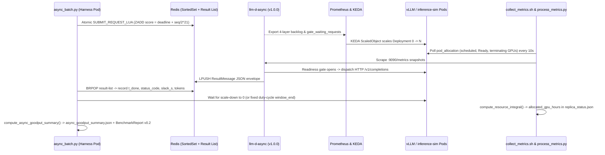

# Async/Batch Autoscaling Goodput: Measurement Mechanism & Implementation Guide

How `llm-d-benchmark` and `llm-d-autoscaling` measure **resource-normalized deadline Goodput** for asynchronous and batch inference workloads under `0 ↔ N` autoscaling (`llm-d-async` `v1.0.0`).

---

## 1. Motivation: Why Synchronous Goodput Does Not Fit Async Autoscaling

Existing `llm-d-benchmark` scoring (`score_slo_goodput` in `llmdbenchmark/agent/score.py`) evaluates **interactive synchronous** serving: it maximizes steady-state `output_token_rate` (tok/s) subject to streaming latency gates (`ttft_ms`, `tpot_ms`) against a static replica pool.

Asynchronous/batch workloads with `0 ↔ N` autoscaling have fundamentally different semantics:

1. **Per-request deadlines replace streaming TTFT/TPOT**: Callers enqueue jobs with explicit Unix completion deadlines ($d_i$) and care whether the completed result arrives before $d_i$, not token-by-token streaming jitter.
2. **Resource elasticity is part of the score**: An Always-On static pool trivially meets deadlines by burning idle GPUs between bursts, while scale-to-zero incurs cold-start provisioning/weight-load latency on scale-up and KEDA stabilization/cooldown hold time on scale-down.
3. **Un-gated ratios can be gamed**: Dividing completed requests by GPU-hours alone would reward an under-provisioned autoscaler that runs `1` tiny replica at 100% saturation while letting 40% of queued deadlines expire (`DEADLINE_EXCEEDED`).

To compare autoscaling controllers fairly (Always-On Baseline, Cron Window `M1`, and 4-Layer Backlog `M2`), `llm-d-benchmark` defines **Deadline-Gated Allocated GPU-Hour Goodput**.

---

## 2. Mathematical Definition & Measurement Mechanism

### 2.1 Per-Request Deadline Accounting (Numerator)

Each submitted request $i \in \{1, \dots, N_{\text{submitted}}\}$ carries:
- Submission timestamp $t_{\text{sub}, i}$ (Unix epoch seconds)
- Absolute deadline $d_i = t_{\text{sub}, i} + B_i$ (where $B_i$ is the cohort's deadline budget in seconds)
- Completion timestamp $t_{\text{done}, i}$ observed when the result envelope is popped from the result queue (or HTTP response returns)

A request is counted as **good (on-time)** if and only if it returns HTTP `2xx` with no `error_code` **and** completes at or before its deadline:

$$\text{good}(i) \iff \bigl(\text{status\_code}_i \in [200, 299]\bigr) \;\land\; \bigl(\text{error\_code}_i = \emptyset\bigr) \;\land\; \bigl(t_{\text{done}, i} \le d_i\bigr)$$

Every non-good request is classified into mutually exclusive failure buckets:
- **Exceeded Deadline (`exceeded_deadline_requests`)**: Broker/processor expired the item (`error_code == "DEADLINE_EXCEEDED"` or HTTP `504`), **or** the request returned HTTP `2xx` late ($t_{\text{done}, i} > d_i$, negative slack $s_i = d_i - t_{\text{done}, i} < 0$).
- **Failed (`failed_requests`)**: Non-deadline transport/5xx errors or uncollected requests after the drain timeout.

From the good set $\mathcal{G} = \{i \mid \text{good}(i)\}$:
- $N_{\text{good}} = |\mathcal{G}|$ (`on_time_requests`)
- $T_{\text{out,good}} = \sum_{i \in \mathcal{G}} \text{output\_tokens}_i$ (`on_time_output_tokens`, extracted from `usage.completion_tokens` with fallback to configured target tokens on simulator backends)
- **Deadline Attainment Rate**:
  $$A = \frac{N_{\text{good}}}{N_{\text{submitted}}}$$

---

### 2.2 Allocated GPU-Hours Integration (Denominator)

To capture the full cost of autoscaling — **cold-start image pull & model load**, **active serving**, and **KEDA cooldown / pod termination** — the denominator integrates **scheduled serving pod GPU capacity** over the benchmark accounting window $[t_0, t_{\text{end}}]$:

$$H_{\text{alloc}} = \frac{1}{3600} \int_{t_0}^{t_{\text{end}}} G_{\text{alloc}}(t)\,dt \quad (\text{GPU-hours})$$

#### Pod Inclusion Rule (`collect_metrics.sh`)
Every `METRICS_COLLECTION_INTERVAL` (default `10s`–`15s`), `collect_replica_status()` queries pods matching `llm-d.ai/inferenceServing=true` (filtered by model label) and classifies each pod:
- **Scheduled (`scheduled_replicas`)**: `spec.nodeName != ""` and `status.phase not in ("Succeeded", "Failed")`. Once the Kubernetes scheduler binds a pod to a GPU node, those GPUs are reserved and billed — even while `Ready=False` during weight loading or while `metadata.deletionTimestamp != null` during graceful drain.
- **Ready (`ready_replicas`)**: Subset of scheduled pods whose `PodReady` condition is `True` and not terminating.
- **Terminating (`terminating_replicas`)**: Scheduled pods with `metadata.deletionTimestamp != null`.
- **GPUs per pod**: Sum of `resources.requests["nvidia.com/gpu"]`, `"amd.com/gpu"`, or `"intel.com/gpu"` across containers (`allocated_gpus`).
- **CPU Simulator Fallback (`virtualGpusPerPod`)**: When `allocated_gpus == 0` (e.g., `llm-d-inference-sim` on CPU clusters), each scheduled pod is weighted by `harness.virtualGpusPerPod` (default `1`) and explicitly tagged `accelerator_mode: "simulated_pod_units"` (vs `"physical_gpu"` on real accelerators) so simulated and hardware numbers are never silently conflated.

#### Piecewise Zero-Order Hold (`process_metrics.py`)
Given ordered snapshots $\{(t_k, G_{\text{alloc}, k}, G_{\text{ready}, k})\}_{k=0}^{M-1}$ clipped or held across $[t_0, t_{\text{end}}]$ (`window_start_epoch` to `window_end_epoch` written by `async_batch.py`):

$$H_{\text{alloc}} = \frac{1}{3600} \sum_{k} G_{\text{alloc}, k} \cdot \Delta t_k, \qquad H_{\text{ready}} = \frac{1}{3600} \sum_{k} G_{\text{ready}, k} \cdot \Delta t_k$$

This also yields the **Autoscaling Overhead Fraction**:

$$\text{overhead\_gpu\_fraction} = 1 - \frac{H_{\text{ready}}}{H_{\text{alloc}}}$$

which isolates the exact fraction of GPU-hours spent in cold-start (`Ready=False`) and scale-down cooldown/termination rather than serving traffic.

#### Accounting Window Modes (`accounting` block in workload profiles)
1. **Scale-to-Zero Cycle (`waitForScaleDown: true`)**: $t_0$ begins at first wave submission; after all requests complete or expire, the harness continues polling until scheduled serving pods return to `settledReplicasTarget` (default `0`, bounded by `scaleDownTimeoutSeconds`) so KEDA's `cooldownPeriod` and `stabilizationWindowSeconds` are billed inside $H_{\text{alloc}}$.
2. **Fixed Duty Cycle (`windowDurationSeconds > 0`)**: Holds $[t_0, t_0 + W]$ (e.g., `1800s` in `hourly_duty_cycle.yaml.in`) so an Always-On Baseline is billed for idle capacity across the entire duty cycle while scale-to-zero controllers (`M1`/`M2`) pay `0` GPU-hours after scaling down.

---

### 2.3 Primary Goodput Metrics & Two-Stage SLO Gate

$$\text{Goodput}_{\text{req/GPU-hr}} = \frac{N_{\text{good}}}{H_{\text{alloc}}}, \qquad \text{Goodput}_{\text{req/GPU-min}} = \frac{N_{\text{good}}}{60 \cdot H_{\text{alloc}}}, \qquad \text{Goodput}_{\text{tok/GPU-hr}} = \frac{T_{\text{out,good}}}{H_{\text{alloc}}}$$

`score_async_goodput()` applies a strict **eligibility gate** (`AsyncGoodputGate`) before ranking strategies:
1. `total_requests > 0` and `allocated_gpu_hours > 0` (otherwise `verdict = "indeterminate"`).
2. `deadline_attainment_rate >= min_deadline_attainment` (default `0.99`; otherwise `verdict = "fail"`).
3. If `require_scale_down=True`, `scale_down_settled is True` (otherwise `verdict = "fail"`, disqualifying static Always-On pools when testing scale-to-zero compliance).
4. Among all arms with `verdict == "pass"`, the winning strategy maximizes `request_goodput_per_gpu_hour`.

---

### 2.4 End-to-End Measurement Pipeline & Empirical Calibration Outputs



Every `async-batch` run also emits two empirical replica calibration parameters in `async_goodput_summary.json`:
- **`calibrated_replica_rps` ($R$)**: `on_time_requests / (ready_pod_hours * 3600)` — achieved per-replica request drain rate while Ready (used to size KEDA `threshold = T_target * R`).
- **`calibrated_cold_start_p90_s` ($C$)**: p90 pod creation-to-Ready latency from `pod_startup_times.json`.

---

## 3. Summary of Repository Changes

### 3.1 `llm-d-benchmark` Changes

| Area | File | Description |
| :--- | :--- | :--- |
| **Metrics Scraping & GPU-Hour Integral** | [`workload/harnesses/collect_metrics.sh`](../workload/harnesses/collect_metrics.sh) | Discovers & scrapes `llm-d-async` pods (`:9090/metrics`); extends `collect_replica_status()` with `epoch_seconds` and pod-level `pod_allocation` (`scheduled_replicas`, `ready_replicas`, `terminating_replicas`, `allocated_gpus`, `virtual_gpus_per_pod`, `accelerator_mode`). |
| | [`workload/harnesses/process_metrics.py`](../workload/harnesses/process_metrics.py) | Registers `llm_d_async_*` backlog/gate/completion metrics; adds `_parse_snapshot_epoch()` and `compute_resource_integral()` writing `resource_integral` into `metrics/processed/replica_status.json`. |
| **`async-batch` Harness & Profiles** | [`workload/harnesses/async_batch.py`](../workload/harnesses/async_batch.py) | Zero-dependency pure-Python `Resp2RedisClient` implementing the exact 5-key `SUBMIT_REQUEST_LUA` contract from `llm-d-async/producer/redis_sortedset_producer.go` (plus `coordinator-http` mode), multi-wave cohort scheduler, `BRPOP` collector, scale-down settlement waiter, and `compute_async_goodput_summary()`. |
| | [`workload/harnesses/async-batch-llm-d-benchmark.sh`](../workload/harnesses/async-batch-llm-d-benchmark.sh) | In-pod benchmark entrypoint: starts `collect_metrics.sh`, runs `async_batch.py`, stops background collectors after cooldown, runs `process_metrics.py`, joins `async_goodput_summary.json`, and exports Benchmark Report v0.2 YAML. |
| | [`llmdbenchmark/analysis/scripts/async-batch-analyze_results.sh`](../llmdbenchmark/analysis/scripts/async-batch-analyze_results.sh) | Idempotent post-run analysis hook invoked by `step_12_analyze_results.py`. |
| | [`workload/profiles/async-batch/sanity_async.yaml.in`](../workload/profiles/async-batch/sanity_async.yaml.in)<br>[`workload/profiles/async-batch/backlog_scaleout.yaml.in`](../workload/profiles/async-batch/backlog_scaleout.yaml.in)<br>[`workload/profiles/async-batch/hourly_duty_cycle.yaml.in`](../workload/profiles/async-batch/hourly_duty_cycle.yaml.in) | Three canonical async workload shapes: smoke test (`50` reqs), backlog scale-out (`3,000` reqs across a 25-min window), and multi-burst periodic duty cycle (`2 x 800` reqs across a 30-min window). |
| | [`workload/README.md`](../workload/README.md) | Documents the `async-batch` harness, profile schema, output files, and Goodput metrics. |
| **Goodput Scoring & Reporting** | [`llmdbenchmark/agent/facts.py`](../llmdbenchmark/agent/facts.py)<br>[`llmdbenchmark/agent/score.py`](../llmdbenchmark/agent/score.py)<br>[`llmdbenchmark/agent/__init__.py`](../llmdbenchmark/agent/__init__.py) | Adds Pydantic models `AsyncGoodputGate`, `AsyncGoodputReport`, `AsyncGoodput`, and `score_async_goodput()` accepting run directories, `async_goodput_summary.json`, or `benchmark_report_v0.2*.yaml`. |
| | [`benchmark-report/llmd_benchmark_report/base.py`](../benchmark-report/llmd_benchmark_report/base.py)<br>[`benchmark-report/llmd_benchmark_report/cli.py`](../benchmark-report/llmd_benchmark_report/cli.py)<br>[`benchmark-report/llmd_benchmark_report/native_to_br0_2.py`](../benchmark-report/llmd_benchmark_report/native_to_br0_2.py) | Adds `WorkloadGenerator.ASYNC_BATCH` and `import_async_batch()` embedding `results.observability.async_goodput`, `resource_integral`, and `async_cohorts`. |
| | [`llmdbenchmark/analysis/summary.py`](../llmdbenchmark/analysis/summary.py)<br>[`llmdbenchmark/analysis/__init__.py`](../llmdbenchmark/analysis/__init__.py) | Surfaces Async Goodput, Deadline Attainment, and Allocated GPU-Hours in per-run analysis summaries. |
| | [`llmdbenchmark/analysis/scripts/async_goodput_comparison_table.py`](../llmdbenchmark/analysis/scripts/async_goodput_comparison_table.py) | Standalone CLI/library rendering side-by-side Baseline/M1/M2 Markdown comparison tables with GPU-hour savings vs baseline and calibrated $R$/$C$. |
| **`llm-d-async` Deployment & Scale-to-Zero** | [`config/templates/values/defaults.yaml`](../config/templates/values/defaults.yaml)<br>[`llmdbenchmark/parser/config_schema.py`](../llmdbenchmark/parser/config_schema.py)<br>[`llmdbenchmark/update/__init__.py`](../llmdbenchmark/update/__init__.py) | Adds `asyncProcessor` config block (`llm-d-async` `v1.0.0`), `helmRepositories.llmDAsync`, `chartVersions.llmDAsync`, and `harness.virtualGpusPerPod`. |
| | [`config/templates/jinja/12a_async-values.yaml.j2`](../config/templates/jinja/12a_async-values.yaml.j2)<br>[`config/templates/jinja/36_async-redis.yaml.j2`](../config/templates/jinja/36_async-redis.yaml.j2)<br>[`config/templates/jinja/10_helmfile-main.yaml.j2`](../config/templates/jinja/10_helmfile-main.yaml.j2)<br>[`config/templates/jinja/20_harness_pod.yaml.j2`](../config/templates/jinja/20_harness_pod.yaml.j2)<br>[`config/templates/jinja/27_keda-scaledobjects.yaml.j2`](../config/templates/jinja/27_keda-scaledobjects.yaml.j2) | Renders `llm-d-async` Helm values, in-namespace Redis Deployment/Service, harness env vars (`LLMDBENCH_ASYNC_REDIS_URL`, `LLMDBENCH_VIRTUAL_GPUS_PER_POD`), and KEDA `cooldownPeriod` / `fallback` / `cron` triggers. |
| | `llmdbenchmark/standup/steps/step_{06,08,10,11}_*.py`<br>[`llmdbenchmark/smoketests/base.py`](../llmdbenchmark/smoketests/base.py)<br>`llmdbenchmark/run/steps/step_{04,05,06,07}_*.py`<br>`llmdbenchmark/teardown/steps/step_{01,03}_*.py` | Deploys/cleans up Redis & `llm-d-async` Helm release; allows `0` initial decode replicas during standup/smoketest/run when `keda.enabled` or `asyncProcessor.enabled` is active; resolves `workload/` assets from `llm-d-benchmark` package root when invoked from sibling repos (`llm-d-autoscaling`). |
| **Test Suite** | [`tests/test_process_metrics_gpu_hours.py`](../tests/test_process_metrics_gpu_hours.py)<br>[`tests/test_async_batch_harness.py`](../tests/test_async_batch_harness.py)<br>[`tests/test_async_goodput_score.py`](../tests/test_async_goodput_score.py)<br>[`tests/test_async_batch_scenarios.py`](../tests/test_async_batch_scenarios.py) | Unit and integration tests covering `0 -> cold-start -> Ready -> terminating -> 0` GPU-hour integrals, TCP socket RESP2 + `SUBMIT_REQUEST_LUA` wire parity, Benchmark Report v0.2 round-trip, SLA disqualification, and cross-repo KEDA scenario rendering. |

---

### 3.2 `llm-d-autoscaling` Scenarios

Located in the sibling `llm-d-autoscaling` repository under `benchmark/config/{scenarios,specification}/staging/async-batch/` (documented in `benchmark/README.md`):

| Strategy Arm | Scenario & Spec | Replicas | Autoscaling Signal | Expected Behavior |
| :--- | :--- | :---: | :--- | :--- |
| **Baseline — Always-On Control** | `baseline.yaml` / `baseline.yaml.j2` | Fixed `2` | `keda.enabled: false` | Meets $\ge 99\%$ attainment with zero cold-start delay, but pays full GPU-hours across idle periods (lowest Goodput on duty-cycle runs; fails `require_scale_down=True`). |
| **M1 — Cron Window** | `cron-window.yaml` / `cron-window.yaml.j2` | `0 ↔ 2` | KEDA `cron` trigger (`desiredReplicas: "2"`) | Scales to `0` outside scheduled batch windows; blind to off-schedule bursts or early queue completion inside the window. |
| **M2 — 4-Layer Backlog** | `backlog.yaml` / `backlog.yaml.j2` | `0 ↔ 2` | KEDA Prometheus sum of `broker_backlog` (gated on `source_available == 1`) + `queue_depth` + `gate_waiting_requests` + `inflight_requests` (`threshold: "2000"`, `activationThreshold: "0.5"`, `cooldownPeriod: 15`) | Reactive `0 ↔ 2` scaling driven by pending work across all four holding layers, draining back to `0` after completion and cooldown. |

All three arms configure a per-queue `prometheus-query` readiness gate (`clamp_max(sum(llm_d_epp_ready_endpoints{namespace=...}) or vector(0), 1)`) on `asyncProcessor.queues[0]` so requests remain pending in `request-sortedset` (`peek, not pop`) during scale-from-zero cold start without `ActionRefuse` re-enqueue churn.

---

## 4. Running & Scoring an Experiment

### 4.1 Standup, Run & Teardown (from `llm-d-autoscaling`)

```bash
# 1. Stand up an arm (use k8s/inference-sim.yaml for CPU sim, or GPU cluster-config on H100s)
llmdbenchmark standup \
  --spec benchmark/config/specification/staging/async-batch/backlog.yaml.j2 \
  --cluster-config benchmark/config/cluster-configs/k8s/inference-sim.yaml \
  --workspace benchmark/results \
  -p bench-async

# 2. Run the backlog scale-out workload
llmdbenchmark run \
  --spec benchmark/config/specification/staging/async-batch/backlog.yaml.j2 \
  --cluster-config benchmark/config/cluster-configs/k8s/inference-sim.yaml \
  --workspace benchmark/results \
  -p bench-async \
  -l async-batch \
  -w backlog_scaleout.yaml

# 3. Teardown before standing up the next strategy arm
llmdbenchmark teardown \
  --spec benchmark/config/specification/staging/async-batch/backlog.yaml.j2 \
  --cluster-config benchmark/config/cluster-configs/k8s/inference-sim.yaml \
  --workspace benchmark/results \
  -p bench-async
```

### 4.2 Generating the Cross-Strategy Goodput Table

```bash
python3 ../llm-d-benchmark/llmdbenchmark/analysis/scripts/async_goodput_comparison_table.py \
  --run-dir "Always-On Baseline=benchmark/results/<baseline-session>" \
  --run-dir "M1 Cron=benchmark/results/<m1-session>" \
  --run-dir "M2 Backlog=benchmark/results/<m2-session>" \
  --baseline-label "Always-On Baseline" \
  --min-attainment 0.99
```

### 4.3 Programmatic Scoring (`llmdbenchmark.agent`)

```python
from pathlib import Path
from llmdbenchmark.agent import AsyncGoodputGate, score_async_goodput

result = score_async_goodput(
    [
        Path("benchmark/results/<baseline-session>"),
        Path("benchmark/results/<m1-session>"),
        Path("benchmark/results/<m2-session>"),
    ],
    gate=AsyncGoodputGate(min_deadline_attainment=0.99, require_scale_down=True),
)
print("Winner:", result.winning_report_path)
print("Best Goodput (req/GPU-hr):", result.best_request_goodput_per_gpu_hour)
```
